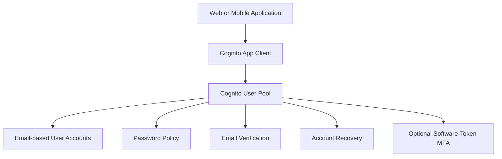
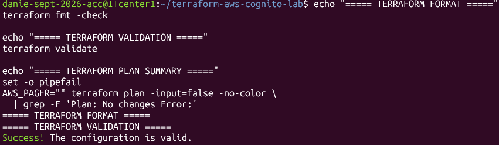

# Amazon Cognito Terraform Lab

## Project Overview

This project demonstrates how to design an Amazon Cognito
User Pool and App Client using Terraform.

Amazon Cognito provides user registration, authentication,
and account management for web and mobile applications.

**Deployment status: PLANNED ONLY — NOT DEPLOYED**

## Architecture



## Planned AWS Resources

| Resource | Count |
|---|---:|
| Cognito User Pool | 1 |
| Cognito User Pool App Client | 1 |
| **Total** | **2** |

## Technical Configuration

- AWS Region: us-east-1
- User Pool: terraform-cognito-lab-user-pool
- App Client: terraform-cognito-lab-app-client
- Username attribute: Email
- Auto-verified attribute: Email
- Minimum password length: 12
- Uppercase letters required: Yes
- Lowercase letters required: Yes
- Numbers required: Yes
- Symbols required: Yes
- MFA: Optional software-token MFA
- Account recovery: Verified email
- Client secret: Disabled
- User existence error protection: Enabled
- Access token validity: 60 minutes
- ID token validity: 60 minutes
- Refresh token validity: 30 days

## Security Design

The User Pool enforces password complexity requirements
and supports verified email addresses.

The App Client uses SRP authentication and supports
refresh tokens.

The App Client does not generate a client secret,
making it suitable for applications that cannot
securely store a client secret.

## Security Limitations

- MFA is optional, not mandatory.
- Advanced threat protection is disabled.
- User Pool deletion protection is inactive.
- No hosted login domain is configured.
- No application frontend is deployed.
- No end-to-end authentication testing was performed.

Production deployments require additional security review.

## Tools

- Ubuntu Linux (WSL2)
- AWS CLI
- Terraform
- Git and GitHub

## Terraform Validation

Commands:

```bash
terraform fmt -check
terraform validate
terraform plan -input=false -no-color
```

Verified results:

- Terraform formatting passed.
- Terraform validation passed.
- Plan: 2 to add, 0 to change, 0 to destroy.

See [Validation Evidence](docs/validation-evidence.md).

## Deployment Status

No terraform apply has been executed.

No Cognito User Pool or App Client has been
created through this Terraform project.

## Cost Considerations

Amazon Cognito pricing depends on usage, feature tiers,
and applicable pricing conditions.

Review current AWS pricing before deployment.

## Future Improvements

- Require MFA for appropriate applications.
- Enable User Pool deletion protection.
- Evaluate advanced threat protection.
- Configure a Cognito managed login domain.
- Add OAuth authorization code flow with PKCE.
- Add application integration tests.
- Add automated security checks.

## Actual Validation Screenshot


