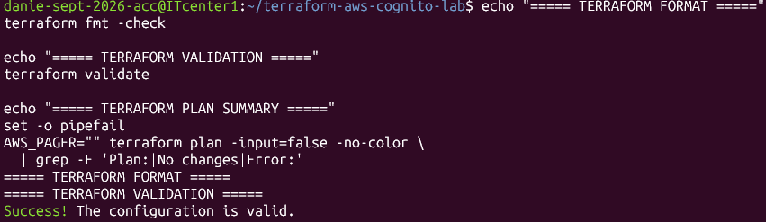

# Amazon Cognito Terraform Validation Evidence

## Status

PLANNED ONLY — NOT DEPLOYED

## Environment

- Ubuntu Linux (WSL2)
- Terraform v1.17.0
- AWS Region: us-east-1
- AWS CLI

## Verified Results

terraform fmt -check:
Passed.

terraform validate:
Success! The configuration is valid.

terraform plan:
Plan: 2 to add, 0 to change, 0 to destroy.

## Planned AWS Resources

1. Cognito User Pool
2. Cognito User Pool App Client

## Security Configuration

- Minimum password length: 12
- Email verification enabled
- Optional software-token MFA
- Verified email account recovery
- Client secret disabled
- User existence error protection enabled

## Security Limitations

- MFA is optional
- Advanced threat protection is disabled
- Deletion protection is inactive

## Deployment Status

No terraform apply executed.

No Cognito resources deployed through this project.

No live authentication testing performed.

## Screenshot

The screenshot should show real terminal validation results.
